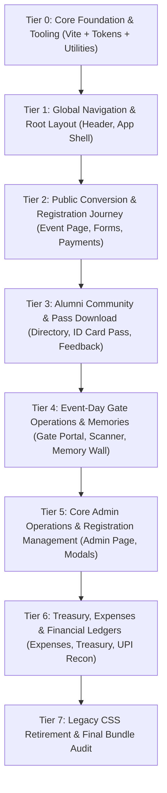

# Comprehensive Component-by-Component Tailwind CSS Migration Plan

This plan encompasses **100% of all UI components, pages, and layout files (35 total)** in the codebase. Every item is ranked strictly in priority order—from the most critical, high-traffic public user touchpoints down to internal admin and ledger utilities.

---

## Migration Tier Overview

---

## Complete Priority Ranking Table (All 35 Files)

| Rank | File Name | Path | LOC | Category | Impact & Priority Rationale |
| :---: | :--- | :--- | :---: | :--- | :--- |
| **0** | `vite.config.ts` & CSS Root | `vite.config.ts`, `src/index.css` | — | **Foundation** | Prerequisites: `@tailwindcss/vite`, theme color variables, reset. |
| **1** | `Header.tsx` | `src/components/Header.tsx` | 171 | **Global Shell** | Present on every single page. Mobile drawer, sticky nav, touch targets. |
| **2** | `App.tsx` | `src/App.tsx` | 33 | **Global Shell** | Page shell, route wrappers, body `overflow-x-hidden` guarantee. |
| **3** | `EventPage.tsx` | `src/pages/EventPage.tsx` | 492 | **Public Core** | Main event portal: hero banner, countdown, dynamic pricing grid. |
| **4** | `EventCard.tsx` | `src/components/EventCard.tsx` | 267 | **Public Core** | Card unit for event listings, dates, badges, and quick actions. |
| **5** | `HomePage.tsx` | `src/pages/HomePage.tsx` | 5 | **Public Core** | Entry point routing to nearest open event or past recap. |
| **6** | `RegistrationForm.tsx` | `src/components/RegistrationForm.tsx` | 1,647 | **Registration Flow** | Highest-stakes conversion form. Mobile inputs ($\ge 16$px), tier radio cards. |
| **7** | `SearchableSelect.tsx` | `src/components/SearchableSelect.tsx` | 190 | **Registration Flow** | Reusable dropdown with search: mobile touch options ($\ge 44$px). |
| **8** | `PaymentSection.tsx` | `src/components/PaymentSection.tsx` | 383 | **Registration Flow** | Dynamic UPI QR card, account details, copy-to-clipboard, ref input. |
| **9** | `UpiPaymentFlowModal.tsx` | `src/components/UpiPaymentFlowModal.tsx` | 81 | **Registration Flow** | Mobile UPI app switcher intent modal (GPay, PhonePe, Paytm). |
| **10** | `SuccessPage.tsx` | `src/components/SuccessPage.tsx` | 273 | **Registration Flow** | Post-registration celebration, pass preview link, WhatsApp sharing. |
| **11** | `IdCardPage.tsx` | `src/pages/IdCardPage.tsx` | 1,474 | **Pass Experience** | Alumni pass lookup, search by phone/reg number, download triggers. |
| **12** | `IdCardPass.tsx` | `src/components/IdCardPass.tsx` | 321 | **Pass Experience** | Visual badge / pass stub, QR code container, responsive print layout. |
| **13** | `AlumniDirectoryPage.tsx` | `src/pages/AlumniDirectoryPage.tsx` | 482 | **Community** | Alumni directory list/grid, search bar, batch filters (deletes `directory.css`). |
| **14** | `AlumniProfileEditModal.tsx` | `src/components/AlumniProfileEditModal.tsx` | 941 | **Community** | Mobile profile update drawer, photo upload, bio/contact editing. |
| **15** | `FeedbackPage.tsx` | `src/pages/FeedbackPage.tsx` | 820 | **Post-Event** | Mobile-friendly feedback & rating form (deletes `feedback.css`). |
| **16** | `ShareWhatsAppModal.tsx` | `src/components/ShareWhatsAppModal.tsx` | 589 | **Social & Sharing** | Viral invite sheet, personalized share links, one-tap mobile forward. |
| **17** | `EventMemoryWall.tsx` | `src/components/EventMemoryWall.tsx` | 477 | **Social & Sharing** | Responsive masonry photo wall, lightbox preview, memory cards. |
| **18** | `EventMemoryManagerModal.tsx`| `src/components/EventMemoryManagerModal.tsx` | 463 | **Social & Sharing** | Admin/organizer photo upload, approval, and caption editor modal. |
| **19** | `GatePage.tsx` | `src/pages/GatePage.tsx` | 216 | **Gate Operations** | Gate landing & staff session checker. |
| **20** | `GatePinLogin.tsx` | `src/components/GatePinLogin.tsx` | 172 | **Gate Operations** | Big numerical keypad for fast entry by gate staff ($\ge 48$px keys). |
| **21** | `GateVerificationPortal.tsx` | `src/components/GateVerificationPortal.tsx` | 2,818 | **Gate Operations** | QR scanner viewfinder, check-in card, meal/pass counter (deletes `gate-and-idcard.css`). |
| **22** | `GateStaffManagerModal.tsx` | `src/components/GateStaffManagerModal.tsx` | 299 | **Gate Operations** | Staff PIN manager modal, session revoke buttons. |
| **23** | `AdminLogin.tsx` | `src/components/AdminLogin.tsx` | 99 | **Admin Core** | Secure PIN / credential login dialog for organizers. |
| **24** | `AdminPage.tsx` | `src/pages/AdminPage.tsx` | 1,447 | **Admin Core** | Master management dashboard, KPI stat cards, tabbed navigation. |
| **25** | `ManageRegistrationModal.tsx` | `src/components/ManageRegistrationModal.tsx` | 310 | **Admin Core** | Single attendee approval, payment mark, tier change, cancel modal. |
| **26** | `QuickManualRegistrationModal.tsx` | `src/components/QuickManualRegistrationModal.tsx` | 1,615 | **Admin Core** | Spot-entry modal at reception with cash/UPI settlement selector. |
| **27** | `EventFeedbackManager.tsx` | `src/components/EventFeedbackManager.tsx` | 718 | **Admin Core** | Feedback sentiment breakdown, score gauges, export actions. |
| **28** | `SponsorshipsManager.tsx` | `src/components/SponsorshipsManager.tsx` | 498 | **Sponsorships** | Sponsor cards, logo showcase, tier badges (Gold/Silver/Platinum). |
| **29** | `SponsorshipModal.tsx` | `src/components/SponsorshipModal.tsx` | 942 | **Sponsorships** | Sponsor creation and logo upload modal. |
| **30** | `CentralTreasuryManager.tsx` | `src/components/CentralTreasuryManager.tsx` | 597 | **Treasury & Finance** | Multi-account summary, Cash-in-Hand balance, bank splits. |
| **31** | `AccountTransferModal.tsx` | `src/components/AccountTransferModal.tsx` | 829 | **Treasury & Finance** | Inter-account fund transfer dialog with verification notes. |
| **32** | `EventExpensesManager.tsx` | `src/components/EventExpensesManager.tsx` | 1,989 | **Treasury & Finance** | Expense breakdown by category, receipts list, payee tags. |
| **33** | `ExpenseModal.tsx` | `src/components/ExpenseModal.tsx` | 2,009 | **Treasury & Finance** | Multi-split expense logger modal with bill photo attachment. |
| **34** | `UpiReconciliationReport.tsx` | `src/components/UpiReconciliationReport.tsx` | 1,675 | **Treasury & Finance** | Financial audit report, receiver rotation logs, unmapped payment matcher. |
| **35** | `main.tsx` & Clean Up | `src/main.tsx` | 13 | **CSS Retirement** | Final removal of obsolete CSS imports (`directory.css`, `gate-and-idcard.css`, `feedback.css`). |

---

## Detailed Component-by-Component Specifications

### Tier 0: Foundation Setup
- **Targets**: `package.json`, `vite.config.ts`, `src/index.css`, `src/lib/utils.ts`.
- **Installations**: `tailwindcss`, `@tailwindcss/vite`, `clsx`, `tailwind-merge`, `lucide-react`.
- **Tailwind Tokens**:
  - `primary`: `#f59e0b` (Amber Gold), `primary-light`: `#fbbf24`, `primary-dark`: `#d97706`.
  - `accent`: `#f97316` (Festive Marigold), `accent-crimson`: `#e11d48`.
  - `bg-base`: `#0a0c16` (Deep Midnight Navy), `bg-surface`: `#111425`, `bg-elevated`: `#1a1e36`.
  - `border-gold`: `rgba(245, 158, 11, 0.3)`.

---

### Tier 1: Global Navigation & Layout Shell
#### #1 `src/components/Header.tsx` (171 LOC)
- **Pain Points**: Fixed header with horizontal navigation clipping on $<400$px screens.
- **Tailwind Implementation**:
  - Container: `sticky top-0 z-50 w-full bg-slate-950/80 backdrop-blur-md border-b border-amber-500/20 px-3 sm:px-6 h-16 flex items-center justify-between`.
  - Mobile Menu: Full-screen or slide-over drawer with $\ge 48$px tap items.
  - Active Event Pill: Fluid `max-w-[160px] sm:max-w-none truncate` badge with gold accent.

#### #2 `src/App.tsx` (33 LOC)
- **Pain Points**: Page roots missing strict horizontal overflow control.
- **Tailwind Implementation**:
  - Root shell: `
`.

---

### Tier 2: Public Conversion & Registration Journey
#### #3 `src/pages/EventPage.tsx` (492 LOC) & #4 `src/components/EventCard.tsx` (267 LOC) & #5 `src/pages/HomePage.tsx` (5 LOC)
- **Pain Points**: Hero image scaling jaggedly; countdown timer columns wrapping unevenly on 360px phones.
- **Tailwind Implementation**:
  - Hero banner: Fluid `w-full aspect-[16/9] sm:aspect-[21/9] object-cover rounded-2xl border border-amber-500/20`.
  - Countdown Grid: `grid grid-cols-4 gap-1.5 sm:gap-3 max-w-sm sm:max-w-md mx-auto`.
  - Pricing Cards: `grid grid-cols-1 sm:grid-cols-2 lg:grid-cols-3 gap-3 sm:gap-4`.

#### #6 `src/components/RegistrationForm.tsx` (1,647 LOC) & #7 `src/components/SearchableSelect.tsx` (190 LOC)
- **Pain Points**: Dense forms with small inputs triggering iOS Safari auto-zoom; attendee add/remove buttons too small for thumb taps.
- **Tailwind Implementation**:
  - Inputs & Selects: `w-full text-base sm:text-sm px-3.5 py-3 rounded-xl bg-slate-900/90 border border-slate-700 focus:border-amber-500 focus:ring-1 focus:ring-amber-500`.
  - Ticket Category Selector: Stacked radio cards with touch target $>50$px: `flex flex-col p-3.5 rounded-xl border border-amber-500/30 active:scale-[0.99]`.
  - Add/Remove Attendee Buttons: `min-h-[44px] min-w-[44px] flex items-center justify-center rounded-lg bg-amber-500/10 text-amber-400`.

#### #8 `src/components/PaymentSection.tsx` (383 LOC) & #9 `src/components/UpiPaymentFlowModal.tsx` (81 LOC)
- **Pain Points**: QR code clipped on narrow viewports; UPI ID copy buttons misaligned.
- **Tailwind Implementation**:
  - QR Code Box: `w-48 h-48 sm:w-56 sm:h-56 mx-auto p-3 bg-white rounded-2xl shadow-xl flex items-center justify-center`.
  - Copy UPI Bar: `w-full flex items-center justify-between gap-2 p-2.5 rounded-xl bg-slate-900 border border-slate-800`.
  - UPI App Switcher Grid: `grid grid-cols-3 gap-3 w-full p-2`.

#### #10 `src/components/SuccessPage.tsx` (273 LOC)
- **Pain Points**: Action buttons squished together; pass card overflowing bottom safe-area.
- **Tailwind Implementation**:
  - Action Stack: `flex flex-col sm:flex-row gap-3 w-full max-w-md mx-auto pt-4`.
  - Pass Download Button: `min-h-[48px] w-full bg-gradient-to-r from-amber-500 to-orange-500 font-semibold rounded-xl text-slate-950 flex items-center justify-center gap-2`.

---

### Tier 3: Alumni Community & Pass Download Experience
#### #11 `src/pages/IdCardPage.tsx` (1,474 LOC) & #12 `src/components/IdCardPass.tsx` (321 LOC)
- **Pain Points**: Large CSS file (`gate-and-idcard.css`); ID badge stub misaligned on print/download.
- **Tailwind Implementation**:
  - Search Input: `w-full text-base px-4 py-3.5 rounded-xl bg-slate-900 border border-amber-500/40`.
  - Pass Canvas: Dedicated card shell with explicit `aspect-[9/16] max-w-[340px] mx-auto sm:max-w-sm` with gold borders and holographic foil effects.

#### #13 `src/pages/AlumniDirectoryPage.tsx` (482 LOC) & #14 `src/components/AlumniProfileEditModal.tsx` (941 LOC)
- **Pain Points**: Heavy `directory.css` (29 KB); table is unreadable on mobile.
- **Tailwind Implementation**:
  - Mobile Card Transformation: Static `table` hidden on $<640$px (`hidden sm:table`), replaced by responsive card grid on mobile (`flex flex-col gap-3 sm:hidden`).
  - Search & Batch Filter Bar: Sticky top bar with horizontal scrolling filter chips (`flex overflow-x-auto gap-2 pb-2 no-scrollbar`).
  - **Milestone: Fully delete `src/directory.css`**.

#### #15 `src/pages/FeedbackPage.tsx` (820 LOC)
- **Pain Points**: Star ratings and feedback chips wrapped inconsistently; uses `feedback.css` (35 KB).
- **Tailwind Implementation**:
  - Rating Emojis/Stars: Fluid flex containers `flex justify-between items-center gap-1 sm:gap-2 max-w-xs mx-auto`.
  - Multi-select question chips: `flex flex-wrap gap-2`.
  - **Milestone: Fully delete `src/feedback.css`**.

---

### Tier 4: Event-Day Gate Operations & Memories
#### #16 `ShareWhatsAppModal.tsx` (589 LOC), #17 `EventMemoryWall.tsx` (477 LOC), #18 `EventMemoryManagerModal.tsx` (463 LOC)
- **Tailwind Implementation**:
  - Masonry Memory Wall: `columns-1 sm:columns-2 lg:columns-3 gap-3 space-y-3`.
  - WhatsApp Share Sheet: Mobile bottom sheet with touch-friendly contact selection cards.

#### #19 `GatePage.tsx` (216 LOC), #20 `GatePinLogin.tsx` (172 LOC)
- **Tailwind Implementation**:
  - PIN Pad: `grid grid-cols-3 gap-3 max-w-[280px] mx-auto`. Keys: `h-16 w-16 text-2xl font-bold rounded-2xl bg-slate-800 active:bg-amber-500 active:text-black`.

#### #21 `GateVerificationPortal.tsx` (2,818 LOC) & #22 `GateStaffManagerModal.tsx` (299 LOC)
- **Pain Points**: Gate portal is the largest single component (2,818 lines) dependent on `gate-and-idcard.css`.
- **Tailwind Implementation**:
  - Scanner Viewport: Responsive camera preview box with pulsing scanning reticle.
  - Verification Cards: Instant green/red badges with large legible text visible under bright sunlight.
  - Counter Stat Ribbon: `grid grid-cols-2 sm:grid-cols-4 gap-2`.
  - **Milestone: Fully delete `src/gate-and-idcard.css`**.

---

### Tier 5: Admin Core & Registration Management
#### #23 `AdminLogin.tsx` (99 LOC), #24 `AdminPage.tsx` (1,447 LOC), #25 `ManageRegistrationModal.tsx` (310 LOC), #26 `QuickManualRegistrationModal.tsx` (1,615 LOC), #27 `EventFeedbackManager.tsx` (718 LOC)
- **Pain Points**: Wide tabular data stretching viewports horizontally; dense modal forms.
- **Tailwind Implementation**:
  - Dashboard Metrics: `grid grid-cols-2 sm:grid-cols-3 lg:grid-cols-6 gap-2 sm:gap-4`.
  - Table Containers: `w-full overflow-x-auto rounded-xl border border-slate-800`.
  - Modal Shells: `fixed inset-0 z-50 flex items-end sm:items-center justify-center p-0 sm:p-4 bg-black/70 backdrop-blur-sm` (drawers on mobile, centered modals on desktop).

---

### Tier 6: Sponsorships, Treasury & Expense Financial Ledgers
#### #28 `SponsorshipsManager.tsx` (498 LOC), #29 `SponsorshipModal.tsx` (942 LOC), #30 `CentralTreasuryManager.tsx` (597 LOC), #31 `AccountTransferModal.tsx` (829 LOC), #32 `EventExpensesManager.tsx` (1,989 LOC), #33 `ExpenseModal.tsx` (2,009 LOC), #34 `UpiReconciliationReport.tsx` (1,675 LOC)
- **Pain Points**: Financial ledgers and split calculators have nested layouts and small form fields.
- **Tailwind Implementation**:
  - Account Balance Cards: `grid grid-cols-1 sm:grid-cols-2 lg:grid-cols-4 gap-3`.
  - Split Transaction Rows: Responsive vertical stacking on mobile (`flex flex-col sm:flex-row gap-2`).
  - Account Switcher Tabs: `flex overflow-x-auto space-x-2 pb-2`.

---

### Tier 7: Final CSS Retirement & Bundle Verification
#### #35 `src/main.tsx` & Complete CSS Deletion
- **Actions**:
  1. Remove `import './gate-and-idcard.css'` from `src/main.tsx`.
  2. Confirm removal of `import '../directory.css'` and `import '../feedback.css'`.
  3. Strip legacy monolithic class definitions from `src/index.css`, leaving only Tailwind `@import` and custom theme variables.
  4. Run `npm run build` to confirm zero bundle warnings and evaluate bundle savings (expecting ~300+ KB reduction).
