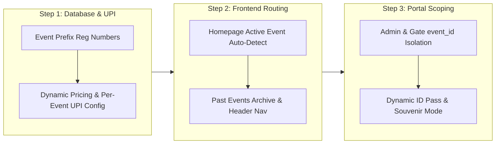

Here is the updated, comprehensive **Action Plan** to make the entire application fully dynamic and multi-event capable, with zero data loss and zero interference across events.

---

### Phase 1: Database & Financial Schema (Zero Table Alterations)

1. **Event-Scoped Registration Numbering**
   * **Problem**: A single global sequence causes registrations to continue indefinitely (`REG-00001`, `REG-00002`... to `REG-00350`+).
   * **Solution**: Update the registration trigger in PostgreSQL:
     * Reads the event prefix (e.g., `DA26` for DeepAura, `NY27` for New Year, `HM27` for Holi).
     * Calculates the sequence per event (`COUNT(*) FROM event_registrations WHERE event_id = ... + 1`).
     * Formats registration as `{PREFIX}-{0001}` (e.g., `DA26-0001`, `NY27-0001`).
     * Existing DeepAura registrations remain 100% intact.

2. **Dynamic Pricing Rules in SQL**
   * **Problem**: `register_for_event()` in `schema.sql` hardcodes ₹800, ₹1,500, and ₹300.
   * **Solution**: Update the PostgreSQL function to calculate totals based on the active event's `pricing_config` (or default `registration_fee`).

---

### Phase 2: UPI Inflows & Expense Outflows (Full Decoupling)

3. **Decouple UPI Accounts & QR Codes**
   * **Problem**: [`src/lib/paymentRotation.ts`](file:///C:/Users/BhaweshKurmi/VisualStudio-projects/eck-alumni-events/src/lib/paymentRotation.ts) hardcodes 4 UPI accounts (Hari, Mitesh, Rajeev, Mukesh) and image files (`/qr-1.png` to `/qr-4.png`) in `DEFAULT_UPI_CONFIGS`.
   * **Solution**:
     * Remove the hardcoded `DEFAULT_UPI_CONFIGS` and `UPI_ACCOUNT_NAMES`.
     * Store and read the UPI receiver list, QR image URLs, and account names directly from `events.upi_rotation_configs` (JSONB) in the database.
     * Fallback to the event's single `upi_id` and `qr_image_url` if multi-account rotation is not configured.
     * Add an interface in the Admin portal to manage UPI accounts and upload QR codes per event.

4. **Dynamic Expense Accounts & Coordinators**
   * **Problem**: [`src/lib/expenses.ts`](file:///C:/Users/BhaweshKurmi/VisualStudio-projects/eck-alumni-events/src/lib/expenses.ts) has a hardcoded list of 10 people in `KNOWN_EXPENSE_ACCOUNTS`, and [`CentralTreasuryManager.tsx`](file:///C:/Users/BhaweshKurmi/VisualStudio-projects/eck-alumni-events/src/components/CentralTreasuryManager.tsx) hardcodes "Mukesh" as the corpus fund custodian.
   * **Solution**:
     * Allow dynamic addition of custom coordinator accounts/banks in the UI.
     * Keep expense ledgers strictly partitioned by `event_id` so DeepAura bills and New Year bills never mix.
     * Central Treasury maintains overall custodian balances (cash/bank in hand) across all events, plus an independent P&L for each event.

---

### Phase 3: Homepage, Navigation & Event Discovery

5. **Auto-Detecting Homepage (`/`)**
   * **Problem**: Root URL `/` currently hardcodes `activeSlug = 'deepaura-2k26'`.
   * **Solution**:
     * On initial load of `/`, query Supabase for the nearest upcoming event:
       ```sql
       SELECT * FROM events 
       WHERE status IN ('OPEN', 'CLOSED') 
       ORDER BY event_date ASC 
       LIMIT 1;
       ```
     * If an event is upcoming, show its hero banner, registration form, and live details.
     * If all events are completed, display the latest event in a **Recap & Memory Wall** mode with a *"Next Event Coming Soon"* announcement.
     * Direct links (e.g. `/events/deepaura-2k26`, `/events/new-year-2027`) continue to work seamlessly.

6. **Past Events Archive & Switcher**
   * Add an **"Events" / "Past Editions"** dropdown in the header and footer:
     * Alumni can click any previous event to view its theme, memories wall, photos, and public transparency report.

---

### Phase 4: Pass Downloads & Gate Verification

7. **Dynamic ID Pass & Souvenir Keepsakes (`/id-card`, `/download-pass`)**
   * **Problem**: Pass lookup hardcodes `'deepaura-2k26'` on both mobile and registration number search; stub title and seal hardcode `"DEEPAURA 2K26"`.
   * **Solution**:
     * Allow selecting the event via an event dropdown or `?event=slug` query parameter (defaulting to the active event).
     * Render the pass dynamically using `event.event_name` and the event's theme colors (`theme_primary_color`, `theme_accent_color`).
     * If downloading a pass for a concluded event, stamp it with an elegant **`EVENT CONCLUDED`** watermark (alumni get a keepsake, gate security remains intact).

8. **Gate Attendance Portal Scoping (`/gate`)**
   * **Problem**: Gate attendance fetches all registrations from all events without an `event_id` filter, and lookups are hardcoded to DeepAura.
   * **Solution**:
     * Require selecting the event to check in.
     * Add strict `.eq('event_id', activeEvent.id)` to queries so gate staff only see and search attendees for the specific active event.

---

### Phase 5: Admin Dashboard & Feedback System

9. **Admin Directory Filter Bug Fix (`/admin`)**
   * **Problem**: Switching the event in Admin updates sponsorships and expenses, but the main **Registrations Directory table** displays registrations from all events combined.
   * **Solution**: Add `reg.event_id === activeEvent.id` into `filteredRegistrations` so the directory strictly isolates attendees per event.
   * Make WhatsApp broadcast templates and confirmation messages dynamically pull `activeEvent.event_name` and `activeEvent.tagline`.

10. **Feedback System Parameterization (`/feedback`)**
    * **Problem**: Questions in [`src/config/feedbackQuestions.ts`](file:///C:/Users/BhaweshKurmi/VisualStudio-projects/eck-alumni-events/src/config/feedbackQuestions.ts) specifically reference DeepAura (e.g., `after_deepaura_feeling`).
    * **Solution**: Convert questions into a dynamic function accepting `{ eventName }`, storing answers under standardized keys.

---

### Implementation Phasing & Milestones



When you are ready to begin, we can start immediately with **Step 1: creating the SQL migration for event-prefixed registration numbering and removing the hardcoded UPI configs in the code**.